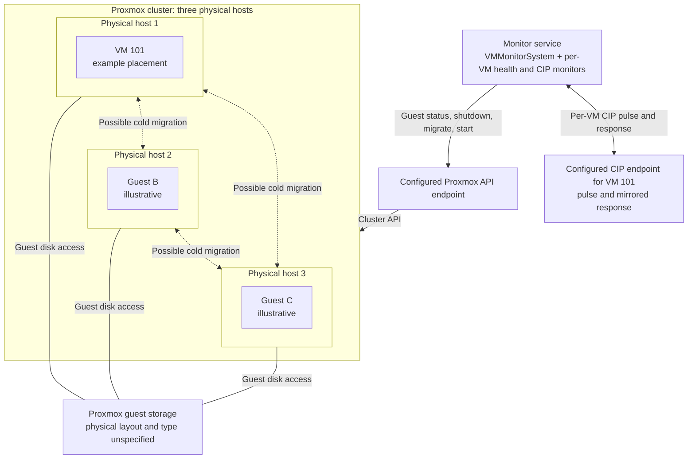

# Proxmox VC4 Monitor

**🐧 Linux-Only Project** - Designed exclusively for Debian/Linux systems with systemd

A robust monitoring and auto-failover system for Crestron VC4 VMs running on a Proxmox HA cluster.

## Table of Contents

- [Features](#features)
- [Quick Start](#quick-start)
- [Installation](#installation)
- [Configuration](#configuration)
- [Usage](#usage)
- [Operations](#operations)
- [Troubleshooting](#troubleshooting)
- [Commands Reference](#commands-reference)
- [Architecture](#architecture)
- [Deployment](#deployment)
- [Files](#files)

## Features

✅ **Per-VM CIP Connections** - Each VM gets its own dedicated CIP connection for reliable health monitoring  
✅ **Container Health Checks** - Monitors Proxmox container status to ensure VMs are running  
✅ **CIP Pulse Monitoring** - Sends regular health pulses to Crestron devices and awaits responses  
✅ **Automatic Failover** - Shuts down unhealthy guests, migrates them offline, and starts them on another cluster node
✅ **10-Second Intervals** - Health checks run every 10 seconds for rapid failure detection  
✅ **Comprehensive Logging** - Full audit trail with per-VM identifiers for easy debugging  
✅ **Post-Install Configuration** - Modify settings anytime without reinstalling  
✅ **Fresh Reinstalls** - Clean uninstall with optional config deletion  

## Quick Start

### Installation (1 minute)

```bash
cd /path/to/proxmox-monitor
sudo bash install.sh
```

### Configuration (2 minutes)

```bash
sudo bash reconfigure.sh
# Opens editor, auto-restarts service
```

Or edit directly:
```bash
sudo nano /etc/proxmox-monitor/config.yaml
```

### Start Monitoring (1 minute)

```bash
sudo systemctl start proxmox-monitor
sudo systemctl enable proxmox-monitor  # Auto-start on boot
sudo journalctl -u proxmox-monitor -f  # Watch logs
```

**That's it!** The monitor is now running.

## Installation

### Prerequisites

- Debian/Linux system
- Python 3.8+
- Proxmox cluster with API access
- Crestron VC4 device(s) with CIP interface
- Root access (sudo)

### Full Installation

```bash
# 1. Navigate to project directory
cd /path/to/proxmox-monitor

# 2. Run installer (creates directories, venv, service, config)
sudo bash install.sh

# 3. This creates:
#    - /opt/proxmox-monitor/                      (application + venv)
#    - /etc/proxmox-monitor/config.yaml           (VM and monitoring configuration)
#    - /etc/proxmox-monitor/proxmox-monitor.env   (credentials)
#    - /var/log/proxmox-monitor/                  (logs)
#    - /etc/systemd/system/proxmox-monitor.service (systemd service)
```

### Post-Install Setup

```bash
# 1. Set Proxmox password in environment file
sudo nano /etc/proxmox-monitor/proxmox-monitor.env
# Edit PROXMOX_PASSWORD=your_password_here with your actual password
# Save and exit (Ctrl+X, Y, Enter)

# 2. Configure your VMs and Crestron devices
sudo nano /etc/proxmox-monitor/config.yaml
# See Configuration section below for details
# Save and exit

# 3. Start the service
sudo systemctl start proxmox-monitor
sudo systemctl enable proxmox-monitor  # Auto-start on boot

# 4. Verify it's running
sudo systemctl status proxmox-monitor
sudo journalctl -u proxmox-monitor -f  # View live logs
```

## Configuration

### Environment File (Credentials)

Located at `/etc/proxmox-monitor/proxmox-monitor.env`

Contains only the sensitive password - all other settings are in `config.yaml`:

```bash
# Edit to set your password
sudo nano /etc/proxmox-monitor/proxmox-monitor.env

# File contents:
PROXMOX_PASSWORD=your_actual_password_here
```

**Important:** 
- File is readable only by root (chmod 600)
- Password is sourced by the systemd service
- Keep this file secure - it contains credentials

### Configuration File Location

```
/etc/proxmox-monitor/config.yaml
```

Edit anytime:
```bash
sudo bash reconfigure.sh      # Recommended (auto-restarts)
# or
sudo nano /etc/proxmox-monitor/config.yaml
sudo systemctl restart proxmox-monitor
```

### Configuration Structure

```yaml
proxmox:
  host: "10.10.10.3"           # Proxmox cluster IP
  user: "root@pam"              # API user
  password: "${PROXMOX_PASSWORD}"  # From environment
  verify_ssl: false             # Usually false for self-signed certs

cip:
  pulse_signal: 1               # CIP signal index (0-based)
  pulse_timeout: 3              # Seconds to wait for response

monitor:
  interval: 10                  # Seconds between health checks
  failure_threshold: 3          # Failures before migration
  migration_timeout: 60         # Per-operation wait and boot grace period before counting failures
  
  vms:
    "101":                       # Proxmox container ID
      cip_host: "10.10.10.10"   # Crestron device IP
      cip_ip_id: 0x13           # Crestron IP ID (hex)

logging:
  level: "INFO"                 # DEBUG, INFO, WARNING, ERROR
  file: "proxmox_monitor.log"
```

### Configuration Examples

**Single VM:**
```yaml
monitor:
  vms:
    "101":
      cip_host: "10.10.10.10"
      cip_ip_id: 0x13
```

**Multiple VMs (same server):**
```yaml
monitor:
  vms:
    "101":
      cip_host: "10.10.10.10"
      cip_ip_id: 0x13
    "102":
      cip_host: "10.10.10.10"
      cip_ip_id: 0x13
```

**Multiple VMs (different servers):**
```yaml
monitor:
  vms:
    "101":
      cip_host: "10.10.10.10"
      cip_ip_id: 0x13
    "102":
      cip_host: "10.10.10.11"
      cip_ip_id: 0x14
    "103":
      cip_host: "10.10.10.12"
      cip_ip_id: 0x15
```

**Performance Tuning:**
```yaml
monitor:
  interval: 15              # Check every 15 seconds (slower)
  failure_threshold: 5      # 5 failures before migration (more tolerant)
  migration_timeout: 120    # 2 minutes per operation or VM boot grace period

cip:
  pulse_timeout: 5          # 5 seconds timeout (flaky networks)

logging:
  level: "DEBUG"            # Very verbose logging
```

### Adding/Removing VMs

Simply add or remove entries under `monitor.vms`:

```yaml
monitor:
  vms:
    "101":
      cip_host: "10.10.10.10"
      cip_ip_id: 0x13
    "102":  # Add this
      cip_host: "10.10.10.11"
      cip_ip_id: 0x14
```

Then restart:
```bash
sudo systemctl restart proxmox-monitor
```

## Usage

### Starting the Service

```bash
# Start
sudo systemctl start proxmox-monitor

# Stop
sudo systemctl stop proxmox-monitor

# Restart (apply config changes)
sudo systemctl restart proxmox-monitor

# Enable auto-start on boot
sudo systemctl enable proxmox-monitor

# Disable auto-start
sudo systemctl disable proxmox-monitor

# Check status
sudo systemctl status proxmox-monitor
```

### Modifying Configuration After Install

**Easy way (recommended):**
```bash
sudo bash reconfigure.sh
# Opens editor and auto-restarts service
```

**Manual way:**
```bash
sudo nano /etc/proxmox-monitor/config.yaml
sudo systemctl restart proxmox-monitor
```

**Verify changes:**
```bash
sudo journalctl -u proxmox-monitor -f
```

### Viewing Logs

```bash
# Real-time logs (live tail)
sudo journalctl -u proxmox-monitor -f

# Last 50 lines
sudo journalctl -u proxmox-monitor -n 50

# Errors only
sudo journalctl -u proxmox-monitor -p err

# Last hour
sudo journalctl -u proxmox-monitor --since "1 hour ago"

# Since last boot
sudo journalctl -u proxmox-monitor -b
```

### Log Output Examples

**Healthy VMs:**
```
2026-11-24 08:30:15 - __main__ - INFO - ✓ [VM 101] HEALTHY (container running, pulse received)
```

**VM Issues:**
```
2026-11-24 08:30:25 - __main__ - WARNING - [VM 102] No CIP response (timeout - 1/3)
2026-11-24 08:30:35 - __main__ - WARNING - [VM 102] No CIP response (timeout - 2/3)
2026-11-24 08:30:45 - __main__ - ERROR - [VM 102] No CIP response (timeout - 3/3)
2026-11-24 08:30:46 - __main__ - WARNING - Migrating VM 102 to next node...
2026-11-24 08:30:56 - __main__ - INFO - VM 102 migration completed successfully
```

## Operations

### Daily Operations

#### Check Service Status
```bash
sudo systemctl status proxmox-monitor
```

#### Restart Service
```bash
sudo systemctl restart proxmox-monitor
```

#### View Configuration
```bash
cat /etc/proxmox-monitor/config.yaml
```

#### Edit Configuration
```bash
sudo bash reconfigure.sh
```

#### Tail Logs
```bash
sudo journalctl -u proxmox-monitor -f
```

### Maintenance

#### Rotate Logs
```bash
# Keep last 30 days
sudo journalctl -u proxmox-monitor --vacuum-time=30d

# Keep last 100MB
sudo journalctl -u proxmox-monitor --vacuum-size=100M
```

#### Backup Configuration
```bash
cp /etc/proxmox-monitor/config.yaml ~/config.yaml.backup
```

#### Restore Configuration
```bash
cp ~/config.yaml.backup /etc/proxmox-monitor/config.yaml
sudo systemctl restart proxmox-monitor
```

### Uninstallation

#### Remove Everything (Optional Config Deletion)
```bash
sudo bash uninstall.sh
# When prompted: type "yes" to delete config (or "no" to keep)
```

This removes:
- Application files and venv
- Systemd service
- Log directory
- **Optionally:** Configuration directory

#### Reinstall After Uninstall
```bash
sudo bash install.sh
sudo bash reconfigure.sh
sudo systemctl start proxmox-monitor
sudo systemctl enable proxmox-monitor
```

## Troubleshooting

### Service Won't Start

```bash
# Check status
sudo systemctl status proxmox-monitor

# View detailed errors
sudo journalctl -u proxmox-monitor -n 20 -p err
```

**Common issues:**

1. **Config file not found**
   ```
   Error: Config file not found: /etc/proxmox-monitor/config.yaml
   ```
   Solution: Run `sudo bash install.sh`

2. **Python import errors** (ModuleNotFoundError: No module named 'proxmoxer')
   ```
   Solution: Venv corrupted. Run:
   sudo bash uninstall.sh
   sudo bash install.sh
   ```

3. **Permission denied**
   ```
   Solution: Run with sudo
   ```

### Can't Connect to Proxmox

```bash
# Test network
ping 10.10.10.3

# Test API
curl -k https://10.10.10.3:8006/api2/json/version

# Check credentials
sudo grep -A 3 "proxmox:" /etc/proxmox-monitor/config.yaml
```

### CIP Pulse Failing

```bash
# Test CIP device
ping 10.10.10.10

# View logs for specific VM
sudo journalctl -u proxmox-monitor -f | grep "VM 101"

# Enable debug logging
sudo sed -i 's/level: "INFO"/level: "DEBUG"/' /etc/proxmox-monitor/config.yaml
sudo systemctl restart proxmox-monitor
# ... check logs ...
sudo sed -i 's/level: "DEBUG"/level: "INFO"/' /etc/proxmox-monitor/config.yaml
sudo systemctl restart proxmox-monitor
```

**Verify Crestron device has pulse mirroring:**
```
DIGITAL_INPUT digitalInput[1];
DIGITAL_OUTPUT digitalOutput[1];

PUSH digitalInput[1]
BEGIN
    digitalOutput[1] = digitalInput[1];
END
```

### VMs Migrating Unexpectedly

1. Check Proxmox cluster health: `https://10.10.10.3:8006`
2. Verify network connectivity to all nodes
3. Check CIP device: `ping 10.10.10.10`
4. Review logs: `sudo journalctl -u proxmox-monitor | grep "UNHEALTHY\|Migrating"`

## Commands Reference

### Installation & Setup
```bash
sudo bash install.sh                    # Initial installation
sudo bash uninstall.sh                  # Complete removal
sudo bash reconfigure.sh                # Edit config + restart
```

### Service Management
```bash
sudo systemctl start proxmox-monitor    # Start
sudo systemctl stop proxmox-monitor     # Stop
sudo systemctl restart proxmox-monitor  # Restart
sudo systemctl status proxmox-monitor   # Status
sudo systemctl enable proxmox-monitor   # Enable auto-start
sudo systemctl disable proxmox-monitor  # Disable auto-start
```

### Configuration
```bash
sudo nano /etc/proxmox-monitor/config.yaml  # Edit directly
cat /etc/proxmox-monitor/config.yaml        # View config
cp /etc/proxmox-monitor/config.yaml ~/config.yaml.backup  # Backup
```

### Logging
```bash
sudo journalctl -u proxmox-monitor -f           # Real-time
sudo journalctl -u proxmox-monitor -n 50        # Last 50 lines
sudo journalctl -u proxmox-monitor -p err       # Errors only
sudo journalctl -u proxmox-monitor -b           # Since boot
sudo journalctl -u proxmox-monitor --since "1 hour ago"  # Last hour
```

### Verification
```bash
systemctl is-active proxmox-monitor && echo "Running" || echo "Stopped"
ps aux | grep "[p]roxmox-monitor"
ping 10.10.10.3                      # Test Proxmox
ping 10.10.10.10                     # Test Crestron
```

## Architecture

### Three-Host Topology

The following is an illustrative three-host deployment, not an inventory of the
configured environment. Host names, guest placement, and storage layout are not
specified in this repository. Only VM 101 is configured in the example
configuration; the other guests illustrate possible placements.



The monitor's deployment location is not specified; the diagram does not imply
a separate physical host. The storage box represents guest storage logically,
not necessarily a single shared device. Storage technology, replication, and
availability must be configured in Proxmox; the monitor does not manage them.

Dashed links show potential guest migration paths, not simultaneous migrations or
an ordered failover chain. After the configured failure threshold, the monitor
selects the first different node returned by the Proxmox API, shuts down the
guest if needed, migrates it offline, and starts it on the target. It does not
verify that the chosen target is healthy or try another target within that
attempt. A stopped guest is first started on its current node and given a boot
grace period. This workflow requires a reachable API and a discoverable guest;
it does not itself guarantee recovery from a physical host outage.

### Per-VM CIP Connections

The monitor maintains independent CIP clients for each configured VM:

```
Monitor → [CIPMonitor for VM 100] → Crestron VC4 (10.10.10.10)
Monitor → [CIPMonitor for VM 101] → Crestron VC4 (10.10.10.10)
Monitor → [CIPMonitor for VM 102] → Crestron VC4 (10.10.10.11)
```

**Benefits:**
- ✅ Isolation - one VM's CIP failure doesn't cascade to others
- ✅ Scalability - add unlimited VMs with independent monitoring
- ✅ Debugging - logs include `[VM id]` tags for clarity
- ✅ Resilience - connection loss is localized, not global

### System Components

| Component | Purpose |
|-----------|---------|
| **ProxmoxManager** | Proxmox API integration (status checks, migrations) |
| **CIPMonitor** | Per-VM CIP connection (pulse send, response wait) |
| **VMHealthMonitor** | Per-VM failure tracking and migration state |
| **VMMonitorSystem** | Orchestrator coordinating all monitors |

### Monitoring Loop (10-Second Cycles)

Each cycle, for every VM:

```
1. Check Proxmox container status
2. Send CIP pulse on VM's dedicated connection
3. Wait for Crestron response (3 second timeout)
4. Record result: HEALTHY or UNHEALTHY

After 3 consecutive failures:
  → Gracefully shut down the guest, migrate it offline, and start it on the target
  → Wait for the boot grace period before counting failures again
```

Offline migration transfers disk changes made since the last replication; it does not
restore the previous replication snapshot. If a shutdown, migration, or start task times
out or its outcome is unknown, monitoring for that guest pauses. Inspect the Proxmox
task and guest location, resolve the outcome, then restart the monitor service.

## Deployment

### Production Checklist

- [ ] Test fresh installation: `sudo bash install.sh`
- [ ] Configure VMs in `config.yaml`
- [ ] Set Proxmox credentials
- [ ] Set Crestron device IPs
- [ ] Verify connectivity to Proxmox cluster
- [ ] Verify connectivity to Crestron devices
- [ ] Check systemd service runs: `sudo systemctl status proxmox-monitor`
- [ ] Watch logs for errors: `sudo journalctl -u proxmox-monitor -f`
- [ ] Test config change with `sudo bash reconfigure.sh`
- [ ] Enable auto-start: `sudo systemctl enable proxmox-monitor`

### Deployment Steps

1. Copy files to server:
   ```bash
   scp -r proxmox-monitor debian@server:/tmp/
   ```

2. SSH to server:
   ```bash
   ssh debian@server
   cd /tmp/proxmox-monitor
   ```

3. Install:
   ```bash
   sudo bash install.sh
   ```

4. Configure:
   ```bash
   sudo bash reconfigure.sh
   ```

5. Start and enable:
   ```bash
   sudo systemctl start proxmox-monitor
   sudo systemctl enable proxmox-monitor
   ```

6. Verify:
   ```bash
   sudo journalctl -u proxmox-monitor -f
   ```

## Files

### Application Files
- **Proxmox_Manager.py** - Main application (604 lines)
- **config_loader.py** - Configuration management
- **requirements.txt** - Python dependencies (proxmoxer, python-cipclient, pyyaml, requests)

### Installation Scripts
- **install.sh** - Main installation script
- **uninstall.sh** - Complete removal with optional config deletion
- **reconfigure.sh** - Edit config and auto-restart service

### Configuration & Service
- **config.yaml** - Your configuration file (EDIT THIS)
- **proxmox-monitor.service** - Systemd service definition

### Documentation
- **README.md** - This file (complete reference)

## Directory Structure (After Installation)

```
/opt/proxmox-monitor/           Application directory
├── Proxmox_Manager.py          Main application
├── config_loader.py            Config management
├── requirements.txt            Dependencies
└── venv/                       Python virtual environment

/etc/proxmox-monitor/           Configuration directory
├── config.yaml                 Your settings (EDIT THIS)
└── proxmox-monitor.env         Environment variables

/var/log/proxmox-monitor/       Logs (via systemd journalctl)

/etc/systemd/system/            System services
└── proxmox-monitor.service     Systemd service
```

## Requirements

- Python 3.8+
- Proxmoxer library (automatically installed)
- python-cipclient library (automatically installed)
- PyYAML library (automatically installed)
- Requests library (automatically installed)

All dependencies are installed automatically via `pip install -r requirements.txt` during installation.

## Support

For issues or questions:

1. Check logs: `sudo journalctl -u proxmox-monitor -f`
2. Verify network connectivity to Proxmox and Crestron devices
3. Review configuration: `cat /etc/proxmox-monitor/config.yaml`
4. Check Proxmox web UI: `https://10.10.10.3:8006`
5. Enable DEBUG logging for detailed output

## License

See repository for license information.

---

**Ready to deploy?**

```bash
sudo bash install.sh
sudo bash reconfigure.sh
sudo systemctl start proxmox-monitor
sudo systemctl enable proxmox-monitor
sudo journalctl -u proxmox-monitor -f
```
